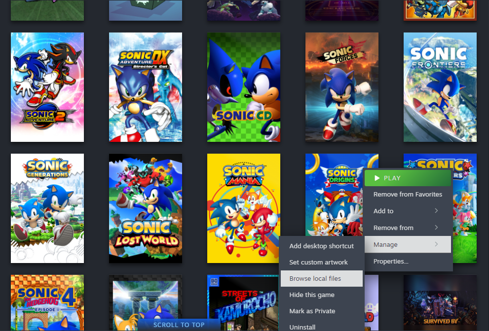
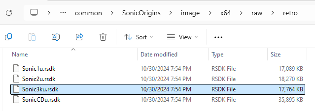
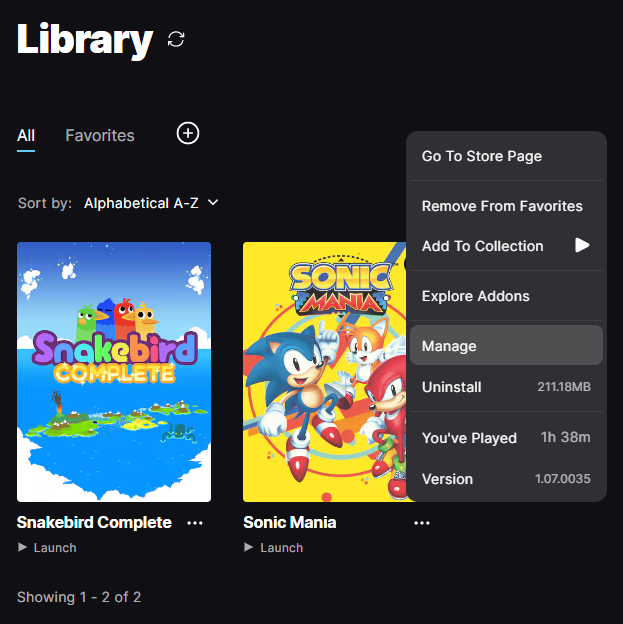
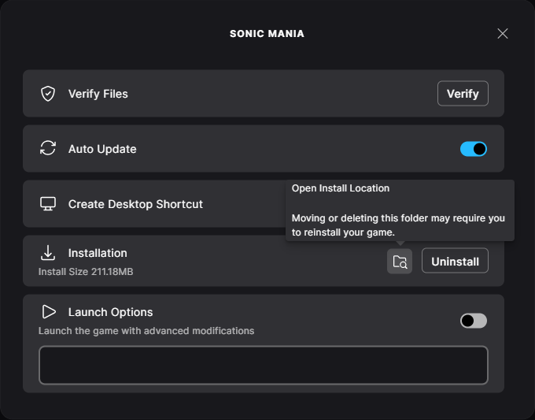
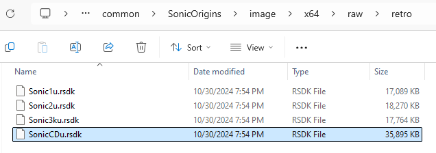

# Obtaining the Sonic 3 & Knuckles Datapack

The datapack for Sonic 3 & Knuckles is required for both playing and modding the game.

## Prerequisites

=== "Steam"

    - Steam installed and running
    - [Sonic Origins installed from Steam](https://store.steampowered.com/app/1794960)

=== "Epic Games Store"

    - Epic Games Launcher installed and running
    - [Sonic Origins installed from the Epic Games Store](https://store.epicgames.com/en-US/p/sonic-origins)

## Obtaining the Datapack

=== "Steam"

    Open your Steam library, then right click Sonic Origins and click `Manage` > `Browse local files`.

    

    In the File Explorer window that appears, open `image/x64/raw/retro`. The datapack for Sonic 3 & Knuckles is `Sonic3ku.rsdk`.

    

=== "Epic Games Store"

    Open your Epic Games library, then right click Sonic Origins and click `Manage`. In the menu that appears, click the :material-folder-search-outline: Open Install Location button next to the Uninstall button.

    { width="50%" }
    { width="49%" }

    In the File Explorer window that appears, open `image/x64/raw/retro`. The datapack for Sonic 3 & Knuckles is `Sonic3ku.rsdk`.

    
